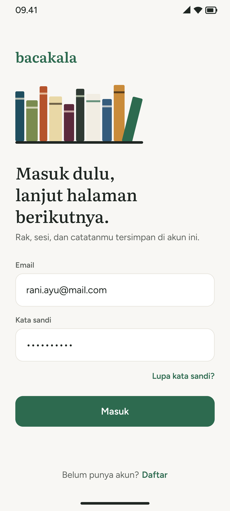
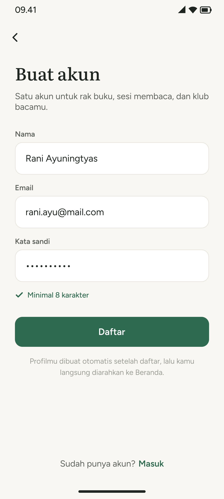
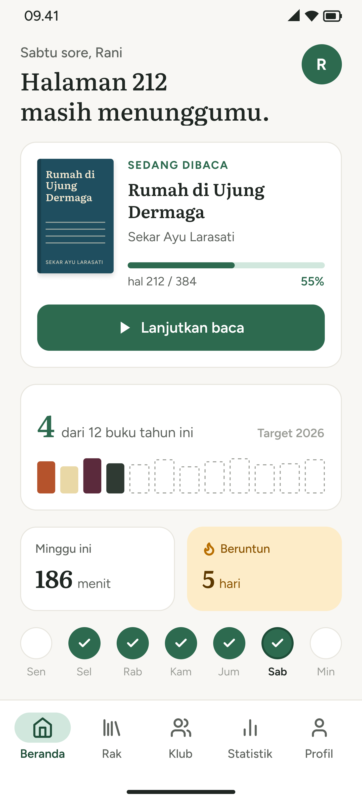

<div align="center">

# 📚 bacakala

**Pelacak kebiasaan membaca dan klub baca untuk Android**

*Baca + kala (waktu): sediakan waktu untuk membaca, pantau perkembangannya, jadikan kebiasaan.*


</div>

---

## Tentang Bacakala

Bacakala adalah aplikasi pelacak kebiasaan membaca untuk perangkat Android yang dikembangkan menggunakan **Flutter** dengan **Supabase** sebagai backend. Aplikasi ini menggabungkan pencatatan bacaan pribadi dan kegiatan membaca bersama dalam satu tempat.

Banyak orang ingin membaca lebih rutin, tetapi kesulitan menjaga konsistensi, tidak mencatat progres, dan menyimpan catatan bacaan di tempat yang terpisah. Bacakala membantu pengguna mengelola rak buku, mencatat sesi membaca, memantau progres, dan membaca bersama teman melalui klub baca. Proyek ini mendukung **SDG 4: Quality Education**, khususnya peningkatan literasi.

> Proyek tugas kelompok mata kuliah **Teknologi Berkembang**, Program Studi Sarjana Sistem Informasi, Institut Teknologi Sepuluh Nopember (ITS), 2026.

## Tampilan

<div align="center">

| Login | Register | Beranda |
|:---:|:---:|:---:|
|  |  |  |

<sub>Desain dari Figma. Screenshot aplikasi akan diperbarui seiring pengembangan.</sub>

</div>

## Fitur

| Fitur | Deskripsi | Status |
|---|---|:---:|
| 🔐 Autentikasi | Daftar, masuk, dan sesi login tersimpan (Supabase Auth) | ✅ |
| 🏠 Beranda | Buku yang sedang dibaca, target tahunan, ringkasan mingguan | 🚧 |
| 📖 Rak Buku | Kelola buku dengan status Ingin Dibaca, Sedang Dibaca, Selesai | ⏳ |
| 🔎 Detail Buku | Progres halaman, riwayat sesi, dan catatan per buku | ⏳ |
| ⏱️ Sesi Membaca | Timer membaca dengan pembaruan progres otomatis | ⏳ |
| 📝 Catatan & Kutipan | Simpan kutipan dan catatan pribadi beserta nomor halaman | ⏳ |
| 📊 Statistik | Total waktu membaca, grafik mingguan, waktu membaca favorit | ⏳ |
| 👥 Klub Baca | Baca satu buku bersama, pantau progres anggota, dan berdiskusi | ⏳ |
| 👤 Profil | Ubah nama, target buku tahunan, dan logout | ⏳ |

<sub>✅ selesai · 🚧 sedang dikerjakan · ⏳ direncanakan</sub>

## Teknologi

- **[Flutter](https://flutter.dev) & Dart**: antarmuka dan logika aplikasi
- **[Supabase](https://supabase.com)**: PostgreSQL, autentikasi, dan Row Level Security
- **Package utama**: `supabase_flutter`, `flutter_dotenv`, `google_fonts`
- **Figma**: design system, user flow, dan wireframe

## Struktur Folder

```
lib/
├── main.dart            # titik awal: muat .env, inisialisasi Supabase, jalankan aplikasi
├── theme/               # warna, font, dan gaya komponen (sesuai Figma)
├── models/              # kelas data: Profile, Book, ...
├── services/            # semua query ke Supabase (auth, profil, buku, ...)
├── screens/             # satu file per screen, dikelompokkan per fitur
│   ├── splash_screen.dart
│   ├── auth/            # login, register
│   └── home/            # beranda
└── widgets/             # komponen yang dipakai ulang (kartu buku, progress bar, navbar)
design/                  # gambar desain dari Figma
```

Alur data: **Screen → Service → Supabase → Model → Screen**. Screen tidak pernah memanggil Supabase secara langsung.

## Cara Menjalankan

**Prasyarat:** Flutter SDK (stable), Android SDK, dan VS Code dengan ekstensi Flutter & Dart. Pastikan `flutter doctor` tidak menampilkan error.

```bash
# 1. Clone repository
git clone https://github.com/NashiwaInsan/Bacakala.git
cd Bacakala

# 2. Buat file .env dari contoh, lalu isi URL dan anon key Supabase
cp .env.example .env        # Windows: copy .env.example .env

# 3. Unduh package
flutter pub get

# 4. Jalankan
flutter run                 # emulator / HP Android
flutter run -d edge         # browser (bisa dipadukan dengan ekstensi Mobile Simulator)
```

Isi `.env`:

```env
SUPABASE_URL=https://xxxxxxxx.supabase.co
SUPABASE_ANON_KEY=eyJhbGciOi...
```

> ⚠️ File `.env` tidak ikut di-commit. Minta URL dan anon key ke anggota kelompok, jangan unggah ke GitHub.

## Alur Kontribusi

1. Ambil versi terbaru: `git checkout main && git pull`
2. Buat branch fitur: `git checkout -b feature/nama-fitur` (contoh: `feature/rak-buku`)
3. Commit dengan awalan jenis perubahan:

   | Awalan | Untuk |
   |---|---|
   | `feat:` | fitur baru |
   | `fix:` | perbaikan bug |
   | `style:` | perubahan tampilan tanpa mengubah logika |
   | `docs:` | dokumentasi |
   | `chore:` | pengaturan project atau package |

4. Push branch, buat **Pull Request** ke `main`, dan minta minimal satu anggota lain untuk review sebelum merge.

## Tim Pengembang — Kelompok 4

| Nama | NRP |
|---|---|
| Bina Ilyas Santosa | 5026241074 |
| Devin Alif Fansyah Yahya | 5026241042 |
| Muhammad Ghazy | 5026241134 |
| Faiz Willy Abiyyu | 5026241166 |
| Axellino Berwin Parlindungan Sinaga | 5026241094 |
| Nashiwa Insan Muflih | 5026241143 |

## Lisensi

Dirilis di bawah [MIT License](LICENSE).
